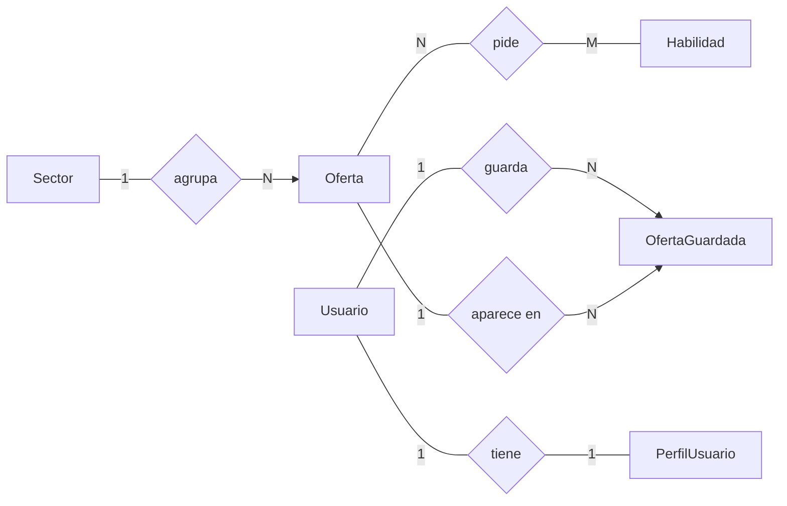

# 💼 Remote Jobs

> **Ofertas de primer empleo y prácticas en remoto o híbrido, en un solo sitio.**

[Funcionalidades](#-funcionalidades) · [Puesta en marcha](#-puesta-en-marcha) · [Modelo de datos](#-modelo-de-datos) · [Estructura](#-estructura) · [Estado](#-estado-del-proyecto)

---

Remote Jobs es una aplicación web hecha con **Django** para encontrar ofertas junior y prácticas que se pueden hacer a distancia. Se puede explorar sin cuenta; al registrarse, cada persona tiene su perfil y su propia lista de ofertas guardadas.

## ✨ Funcionalidades

| | Qué permite hacer |
| --- | --- |
| 🔎 **Búsqueda** | Palabras clave y filtros combinables: sector, habilidad, modalidad, tipo de empleo, ubicación, salario y fechas. |
| ↕️ **Orden y paginación** | Ordenar por fecha, título o salario. Los filtros se mantienen al cambiar de página. |
| 🗂️ **Sectores y habilidades** | Directorios con página propia que enlazan a las ofertas relacionadas. |
| 👤 **Cuentas** | Registro, acceso con correo o usuario, cambio y recuperación de contraseña. |
| 🔐 **Google** | Inicio de sesión con Google mediante `django-allauth` (opcional, con credenciales propias). |
| 🧑‍💼 **Perfil** | Nombre, titular, ubicación, biografía, portfolio y foto, subida o tomada de Google. |
| ⭐ **Guardadas** | Lista privada de ofertas por cuenta. |
| 🛠️ **Administración** | Gestión de ofertas, sectores, habilidades y perfiles desde `/admin/`. |
| 🧪 **Datos de demo** | `cargar_datos_demo` crea 6 sectores, 18 habilidades y 9 ofertas, y se puede repetir sin duplicar. |

La interfaz se genera en el servidor con plantillas de Django, sin JavaScript propio: la búsqueda y los filtros son formularios normales. Los estilos están en un único CSS adaptable a móvil.

<details>
  <summary><h2>Cambios y añadidos respecto al enunciado</h2></summary>

  ### Decisiones de diseño

  - **Portada:** se ha optado por mostrar una selección de las ofertas más recientes y un resumen de los sectores disponibles, en lugar de mostrar una oferta de cada sector. Consideramos que esta alternativa ofrece una presentación más clara y evita que la portada crezca excesivamente a medida que aumente el número de sectores. Para consultar las oportunidades en detalle se dispone de un buscador específico.

  ### Funcionalidades adicionales

  - **Búsqueda avanzada:** filtros combinables por sector, habilidad, modalidad, tipo de empleo, ubicación, salario y fecha de publicación. También permite buscar por palabras clave y ordenar los resultados.
  - **Paginación:** los listados de ofertas se dividen en páginas y mantienen los filtros aplicados al navegar.
  - **Cuentas de usuario:** registro e inicio de sesión mediante correo electrónico o nombre de usuario.
  - **Autenticación con Google:** posibilidad de iniciar sesión mediante Google OAuth, previa configuración de las credenciales correspondientes.
  - **Perfiles personales:** cada usuario puede personalizar su perfil con nombre público, titular profesional, ubicación, biografía, portfolio e imagen de perfil.
  - **Gestión de contraseñas:** cambio y recuperación de contraseña mediante los mecanismos de Django.
  - **Ofertas guardadas:** los usuarios registrados pueden guardar ofertas en una lista personal para consultarlas posteriormente.
  - **Administración personalizada:** se ha ampliado el panel de administración de Django con filtros, búsquedas, ordenación y visualización de información relacionada para facilitar la gestión de las entidades.
  - **Información adicional de las ofertas:** se incluyen datos como empresa, modalidad, tipo de empleo, ubicación, rango salarial, requisitos, beneficios y fecha de publicación.
  - **Directorios mejorados:** los sectores y habilidades muestran información adicional, categorías o número de ofertas relacionadas, y permiten ordenar y filtrar sus resultados.

</details>

## 🚀 Puesta en marcha

Desde la carpeta que contiene `manage.py`:

```bash
python -m venv .venv
# activa el entorno virtual (ver CONFIGURACION.md) y luego:
python -m pip install -r requirements.txt
cp .env.example .env          # en PowerShell: Copy-Item .env.example .env
python manage.py migrate
python manage.py cargar_datos_demo
python manage.py runserver
```

La web queda en <http://127.0.0.1:8000/>. Para entrar en `/admin/` crea antes un administrador con `python manage.py createsuperuser`.

Las variables de entorno, Google OAuth, el correo y las notas de despliegue están en **[CONFIGURACION.md](CONFIGURACION.md)**.

## 🧩 Modelo de datos

La **oferta** es el centro del modelo: pertenece a un sector, pide varias habilidades y puede ser guardada por muchas personas. Cada usuario de Django tiene además un perfil.



Cada rombo es una relación y el número junto a cada caja indica cuántos elementos de esa entidad intervienen. Por ejemplo, un sector agrupa muchas ofertas, pero cada oferta tiene un solo sector. `OfertaGuardada` es la tabla intermedia que une usuarios y ofertas: una persona guarda muchas ofertas y una oferta la guardan muchas personas, es decir, una relación de muchos a muchos.

Validaciones propias: el salario máximo no puede ser menor que el mínimo, y las fotos de perfil deben ser JPG, PNG o WebP de hasta 3 MB.

## 📁 Estructura

```text
Remote_Jobs_IW/
├── manage.py
├── requirements.txt
├── .env.example
├── Remote_Jobs/                 # Configuración del proyecto (settings, urls, wsgi/asgi)
└── App_Remote_Jobs/             # La aplicación
    ├── models/                  # Sector, Habilidad, Oferta, PerfilUsuario, OfertaGuardada
    ├── views/                   # Ofertas, sectores, habilidades, cuentas, favoritos
    ├── templates/               # base.html, páginas y componentes reutilizables
    ├── static/.../estilos.css   # Hoja de estilos única
    ├── management/commands/     # cargar_datos_demo
    ├── forms.py  urls.py  admin.py
    ├── backends.py              # Acceso con correo o nombre de usuario
    ├── adapters.py              # Perfil a partir de los datos de Google
    ├── signals.py               # Crea el perfil al crear la cuenta
    └── context_processors.py    # Perfil y favoritos disponibles en todas las plantillas
```

## 🚧 Estado del proyecto

Es un proyecto de equipo en fase de desarrollo, y conviene tener claro hasta dónde llega:

- Los datos son de demostración; la solicitud de cada oferta remite a una URL externa.
- Hay una única prueba automática (la portada responde): `python manage.py test`.
- La verificación de correo al registrarse está desactivada, y el correo de recuperación se escribe en la consola por defecto.
- Usa SQLite y almacenamiento local de imágenes. Para publicarlo habría que ajustar varias cosas, listadas en [CONFIGURACION.md](CONFIGURACION.md#despliegue).

## 👥 Equipo

Proyecto realizado por Aritz, Iker, Oier y Ander. El uso de herramientas de apoyo se explica en [USO_IA.md](USO_IA.md).
